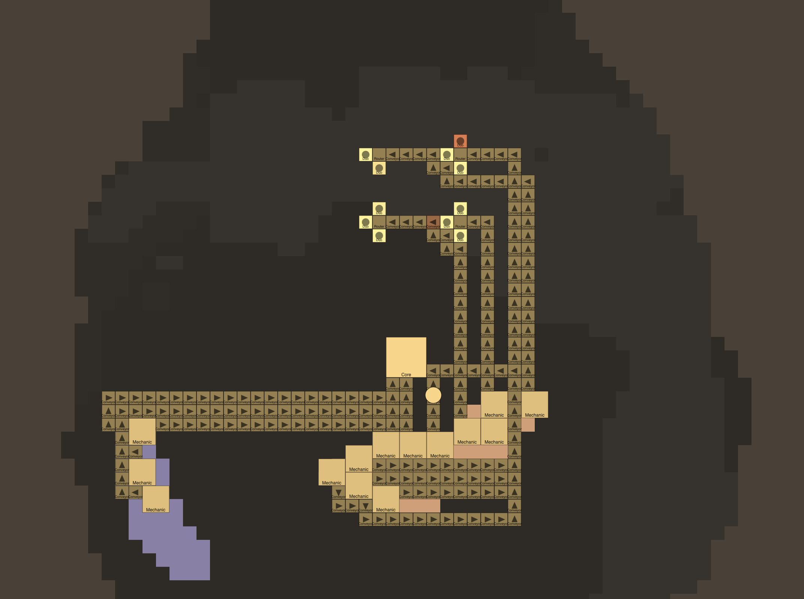
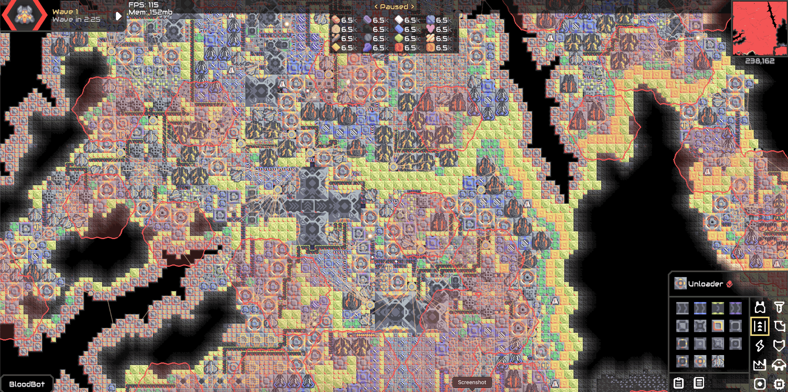
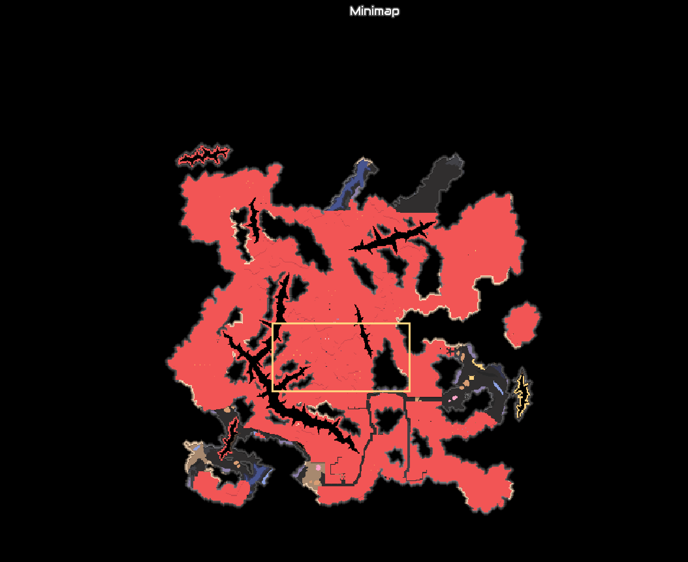

# 2026-10-28: Initial Training

I wanted to make a bot to beat the Mindustry map Bloodshed Bastion because I'm interested in AI and gaming. (Mindustry is a game where you build a factory to defend against enemy robots and send your own robots to destroy their base.) I had just recently watched the documentary The Thinking Game, about DeepMind's initial AI training and the part about how they trained their StarCraft 2 bot was really cool. I thought of making a bot to play Mindustry, a game that I play. So, I tried just starting, and the bot did pretty well. Then, I realized that it wasn't learning, it was just copying human strategies! Then, I changed it to a self-learning mode where it starts from "place blocks randomly" and continues to play lots of games until it's better than any human could ever be.

## Server

I ran the game by opening a server that could play games at about 35x real time, which I initially thought was amazing, but turned out to be pretty slow. That meant that each game took about 15 (if it died right away) to 40 (if it almost won) seconds per game, which ended up taking FOREVER. Then, I realized that I could just run it on three servers, which tripled the speed of it, effectively meaning that each match took 5 to 15 seconds, which was great. This seems to be the best that this computer can handle, but maybe at some point I'll try out four servers.

## Map survey: how the built-in maps behave with no player

I checked most of the pre-built maps, and all of them were meant for good players. So, I had an idea. I remembered from when I made a Mindustry mod that the campaign map files were easy to get to, so I downloaded the first three, then some other maps to get the bot to beat before Bloodshed Bastion, to train the bot.
The first map is Ground Zero, a easy survival map. Then Frozen Forest, Cratered Battleground, then Fungal Pass, the first attack map, then USS IOWA, a difficult attack map. Then we will move on to Space Gardens, a PVP (or AIvsAI) map where the bots will fight each other to build strategy. Finally, we will send it into Bloodshed Bastion, the hardest Mindustry map ever created. 

Each map is played at 30% → 55% → 80% → 100% enemy strength. A good way to think about the bots getting better is a sports team. A trainer that I use called PyTorch that's built to help machines learn fast is the coach. The 10 bots are the players. The players go play a game, then the coach talks to the players about what they could do to get better with personalized feedback. Then, the trainer tells the top 5 things that the bots did (place a conveyor, attack an enemy, etc.) to the bots to try out next time in addition to the personal feedback. This is how the bots get better.
