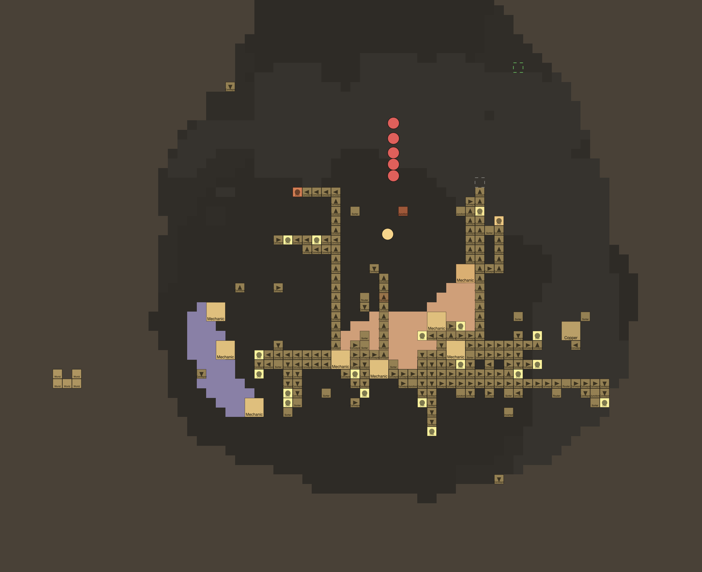
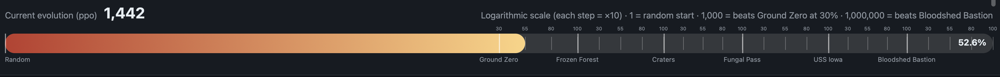

# 2026-10-29/30: Evolution time!

This was great! The bot has played 1.2k games and finally beat Ground Zero at 30%! It's working through 55% and currently clears it (finishes with over 50% Core HP) about 30% of the time. The other times, it mostly doesn't build anything, so I added some artificial score bonuses whenever it builds things, and that's helping. 

Then, the scores for AIs suddenly started skyrocketing, multiplying their scores by at least 10 times. Initially, I was excited, but this couldn't be growth, not this fast. 10x is way too fast. I checked, and it turned out that the rewards for the AIs in score were being exploited! In the past, the AIs had been sitting there doing nothing, so I added score bonuses for moving after waiting. It was intended to stop the AI from staying in one spot, but they had exploited it. The AIs realized they could farm this by waiting, then moving, then waiting, and continuing to do this hundreds of times! 

This is called ***Reward hacking*** or ***specification gaming***. It basically means that the bot has found a loophole in the rules it has to follow and uses it to get the most points possible (which is, after all, what it's supposed to do). OpenAI actually had an issue like this when they were trying to make a boat-racing bot that learned that it would get more points if it spun around crazily instead of following the course. Designers of AI systems for playing games (and other things) have to be careful and watch the bot carefully to make sure it's not hacking the system. I capped the score bonus so that they would stop it. The bot can now score the bonus a few times, but then it doesn't get any points for continuing to do it, which stopped the farming. We are currently at about 330 rounds of evolution, and it's getting better really fast! It seems to be mostly placing LOTS of mechanical drills and conveyors, while also occasionally scattering around the occasional pointless block. Hopefully it stops doing that :(

