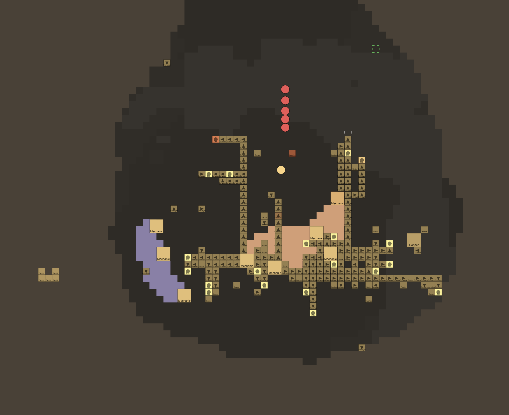
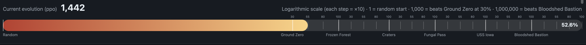

# 2026-10-29/30: Evolution time!

This was great! The bot's played 1.2k games and beat Ground Zero at 30% finally! It's working through 55% and currently clears it (finishes with over 50% Core HP) about 2% of the time. It needs to CLEAR it, not just win it, to advance to the next strength level. It wins the map WAY more times, more like 30%! It's learned how to build basic turret setups, mine copper and lead, and it just now figured out how to set up Scatter turrets for specialized killing of Air units! So yeah, it's going well.

Then, the scores for AIs started skyrocketing, multiplying their scores by at least 10 times. This couldn't be exponential growth, not this fast. I checked, and it turned out that the rewards for the AIs in score were being exploited! In the past, the AIs had been sitting there doing nothing, so I added score bonuses for moving after waiting. The AIs realized they could farm this by waiting, then moving, then waiting, and continuing to do this hundreds of times! I capped the score bonus so that they would stop it. We are currently at about 330 rounds of evolution, and it's getting better really fast! It seems to be mostly placing LOTS of mechanical drills and conveyors, while also occasionally scattering around the occasional pointless block. Hopefully it stops doing that :(
I just added a new metric called Evolution that measures how well it's doing.

