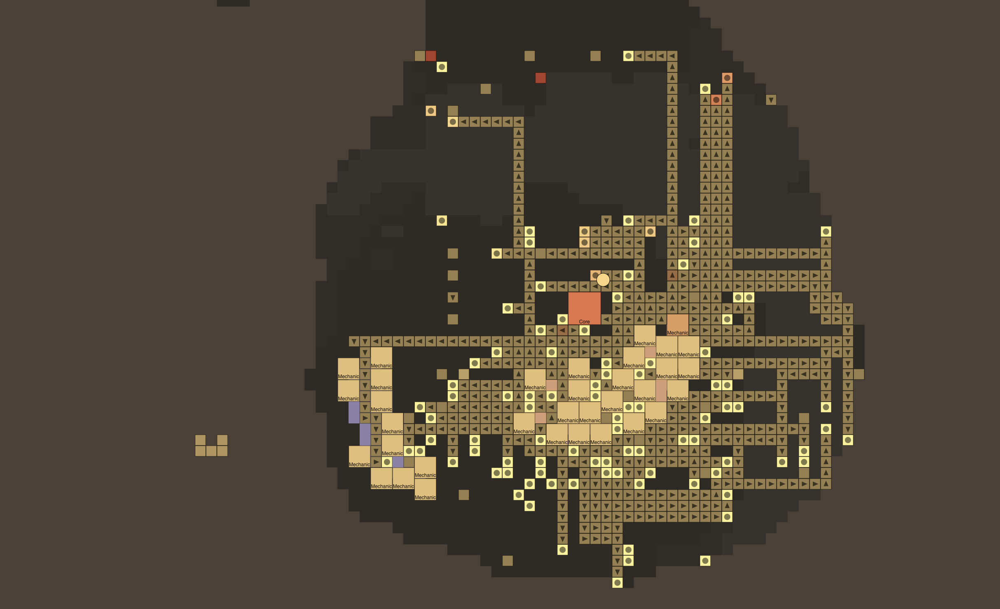

# 2026-10-31: A bigger brain and a second pair of eyes

I increased the brain size by 4x, which seems to make it better. If my brain was four times as big, hopefully I would have already made a bot that could beat BB :( So it's beaten 55% and it's working through 80%. The flamethrower enemies (maces) on the last few waves seem to really annoy the AI. It got a new record on points in game 1470, where it won. Right now we have 10 wins (about 8%) on 80% difficulty. On game 1397, for some reason the bot decided to build ONE THOUSAND AND FORTY SEVEN blocks and it somehow won!

## Where it stands

| | |
|---|---|
| Ladder level | Ground Zero, 80% enemy strength |
| Games today | 127 (games 1380–1506) |
| Wins today | 9 (7%) |
| Best score ever | 3,852 (game 1470, new record; the old one was 3,322) |
| Most blocks in one game today | 1,047 (game 1397, a win) |
| Evolution | 1,940 (54.8% of the way to Bloodshed Bastion), past Noob |

> ✍️ *How close does it feel to beating 80%?*

## Every win today

| Game | Core left | Brain |
|---|---|---|
| 1397 | 35% | 64 neurons |
| 1404 | 59% | 64 neurons |
| 1416 | 56% | 64 neurons |
| 1434 | 44% | 64 neurons |
| 1438 | 27% | 256 neurons |
| 1442 | 35% | 256 neurons |
| 1470 | 16% | 256 neurons (best score ever) |
| 1480 | 43% | 256 neurons |
| 1503 | 5% | 256 neurons |

## A bigger brain: 64 → 256 neurons per layer

The brain went from about 49,000 numbers to about 224,000. It was widened in place, so it kept everything it had learned.

| | 64 neurons (games 1380–1435) | 256 neurons (games 1436–1506) |
|---|---|---|
| Games | 56 | 71 |
| Win rate | 7% | 7% |
| Average wave | 6.3 | 7.8 |
| Average blocks | 316 | 421 |
| Games that reached wave 9+ | 17 (30%) | 40 (56%) |

Same win rate, but it gets much further: more than half its games now reach the last two waves.

> ✍️ *Was it worth it?*

## Turrets

| Per game (today) | |
|---|---|
| Turrets fed with ammo | 16.9 |
| Turrets that actually hit an enemy | 11.4 (67%) |
| Built blocks that never carried anything | 115 |

Yesterday's reward changes are working: turrets only earn their +50 when they hit something, and unused blocks cost −5 each.

> ✍️ *What you saw when you watched it.*

## Why it still loses at 80%

From comparing a lost game (1357) with a won one (1338), wave by wave:

| | Won game | Lost game |
|---|---|---|
| Core before wave 9 | 93% | 30% |
| Core after wave 9 | 41% | 0% |
| Copper in the core by wave 5 | ~950 | 0 |

Wave 9 brings maces, which copper duos barely hurt, and Ground Zero has no coal for graphite. The bot that loses has already been leaking core since wave 3, because it ran out of copper.

> ✍️ *What would you do in its place?*

## Two views, like AlphaStar

The bot used to see the whole map squeezed into a 32×32 picture. Now it also gets a close-up: a 32×32-tile window at full detail around its ship.

| | Minimap | Close-up (new) |
|---|---|---|
| Covers | the whole map | 32×32 tiles around the ship |
| One square = | ~8 tiles on Ground Zero, ~16 on Space Gardens | 1 tile |
| Map layers | 23 | 23 |

The close-up started switched off (zero weights), so the bot kept everything it knew and has to learn to use it.

## In the mod

The mod now plays the trained PPO brain (the 256-neuron one).

> ✍️ *How it played against you on Space Gardens and Ground Zero.*

## Next

> ✍️ *What's next: chokepoint and wall rewards, then clearing 80%.*
