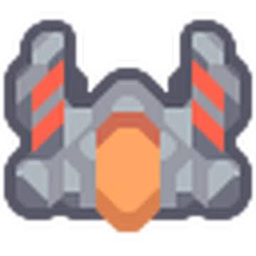

# 2026-10-31: A bigger brain and a second pair of eyes

I increased the brain size by 4x, which seems to make it better. If my brain was four times as big, hopefully I would have already made a bot that could beat BB :( So it's beaten 55% and it's working through 80%. The flamethrower enemies (maces) on the last few waves seem to really annoy the AI. It got a new record on points in game 1470, where it won. Right now we have 10 wins (about 8%) on 80% difficulty. On game 1397, for some reason the bot decided to build ONE THOUSAND AND FORTY SEVEN blocks and it somehow won!

So far it seems like the bot is better than a first-time player who has played the tutorial. There's no tutorial for the bot, so over 1.5 thousand games, we've accomplished what one tutorial could do for a human player! Still, it is growing fast. It seems to get a new record every day, and (so far) it gets to a new difficulty every day. I don't expect that to keep up, but I sure hope it does.

When the brain got upgraded, it still had the same win rate, which was annoying, but the percentage of games reaching the final wave almost doubled! (30% to 56%.) It's still early after the upgrade, but I hope it continues to grow!

It's so fun to see the bot doing something instead of scattering blocks. I give the AI points every time it hits an enemy with a turret, clears a wave, gets resources, and a host of other helpful things. I penalize it when it gets hit, loses (of course), doesn't build anything in a game, or some other things as well.

The bot keeps dying on Wave 9 and Wave 10 because some tougher enemies, those flamethrower bots, the maces, start to come then. The weapons the bot has to fight them with aren't powerful enough to kill the maces as fast as the smaller ones. The bot hasn't learned yet to build walls to stop the enemies just walking right through the defense. 

The close-up started switched off (zero weights), so the bot kept everything it knew and has to learn to use it.
The bot used to just see the entire big map squeezed down into a little picture, so I did some research on how to better make it see the terrain. DeepMind's bot actually saw one squeezed picture like that, and it saw one zoomed-in picture near it! I tried that, and it seems to be working much better. DeepMind people are pretty smart to come up with that.

Just for fun, I opened Mindustry and played against three of it for a few minutes, and the bots mostly just sat around and mined resources without building, which was not what I was hoping for. The bot's only EVER played on ground zero, so it doesn't know what all of this new stuff was. It's like if you were dropped into an alien world. You wouldn't know anything! Maybe you'd see water, and understand that, but you wouldn't know a lot of things. That's what the bot is thinking when it's dropped into a new map.
Next time, I hope it can beat 80%! Happy Halloween!
