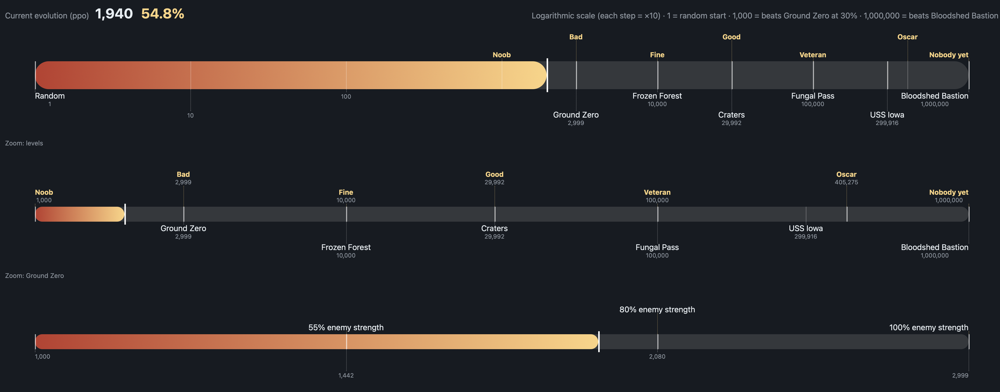

# 2026-11-01-06: Learning in cycles

In the last week, I worked on recovering from a big slump at the end of the last few times. After some new rewards I added, it started slumping and getting worse. I looked at why, and didn't find a clear reason. I reset to about 200 games before to remove the slump and make it recover, changing some of the rewards. Then it did better, reaching the last two waves on 80% difficulty about half the time. A few days later, I was stuck in a cycle of make changes --> wait 1 hr while bot runs --> bot gets worse --> undo changes --> wasted time. I was getting really frustrated and it was starting to feel like a waste of time.

Then I did some looking into the code, and it turned out there was a line of code that was blocking the bot from mining and other important things! ONE LINE that had wasted hours! I deleted it and started another hour skeptically. At the end, it had not only cleared 80% (and won 10x as many times) it had almost cleared 100%! This was a huge breakthrough. I still can't believe one line of code had wasted that much time.

The cursed line of code: if(builder.core() == null || Vars.state.updateId % DECIDE_TICKS != 0 || builder.queue.size >= MAX_QUEUE) return; That basically means: whenever the bot had 6 or more builds waiting (MAX_QUEUE = 6), it stopped making decisions at all. With no copper, those builds could never finish, so it couldn't order mining to get copper either, and it froze, which led to it being frozen 35% of the time, which led to it wasting minutes and minutes on nothing, which led to me getting very frustrated. Then the next day, I ran the bot for another hour, and within 10 minutes, it cleared Ground Zero at 100% Strength. I couldn't believe it. On to Frozen Forest!

