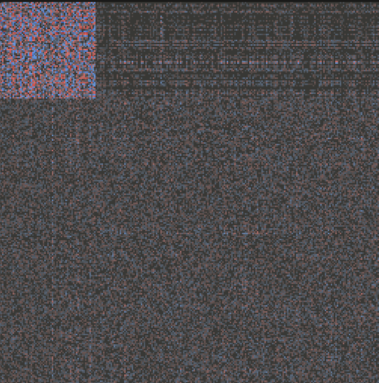

# 2026-11-01: Recovering and learning

Today I worked on recovering from a big slump at the end of last time. After some new rewards I added, it started slumping and getting worse. I looked at why, and didn't find a clear reason. I reset to about 200 games before to remove the slump and make it recover, changing some of the rewards. Now it's doing better, reaching the last two waves on 80% difficulty about half the time. I hope it continues to do well!

I think it got worse during slump

## Every win since the last post

| Game | Core left |
|---|---|
| 1525 | 6% |
| 1595 | 52% |
| 1609 | 48% |
| 1666 | 9% |
| 1674 | 16% |
| 1688 | 14% |
| 1698 | 2% |

No wins in the last 96 games.

## Reward changes

| From game | Change |
|---|---|
| 1566 | −10 points per 1% of core health lost; +100 extra for a win |
| 1629 | Learns every 1,024 decisions (was less often) |
| 1672 | +100 per mace killed |
| 1723 | Tried less exploration (0.005); it got timid and built less |
| 1749 | Back to normal exploration (0.01) |
| 1761 | Walls earn +1 per 20 HP of enemy damage they soak (max 300 a game) |
| 1761 | Turret hits and mace kills pay up to 3× more the farther they are from the core |
| 1791 | +30 per turret fed by a router (was +50 once a game), also up to 3× farther out |

> ✍️ *Which change do you like best, and why?*

## How each change did

| Games | Change in effect | Games played | Wins | Avg wave | Avg blocks | Reached wave 9+ | Turrets fed / hitting |
|---|---|---|---|---|---|---|---|
| 1507–1565 | (none, the two views from last post) | 59 | 1 | 6.8 | 342 | 24% | 13.9 / 9.6 |
| 1566–1671 | core health + win bonus | 106 | 3 | 7.5 | 317 | 29% | 13.7 / 9.8 |
| 1672–1722 | mace bonus | 51 | 3 | 7.8 | 256 | 37% | 12.5 / 10.1 |
| 1723–1748 | less exploration | 26 | 0 | 6.9 | 167 | 19% | 8.5 / 7.0 |
| 1749–1760 | normal exploration again | 12 | 0 | 6.3 | 205 | 8% | 9.2 / 7.3 |
| 1761–1790 | walls + forward defense | 30 | 0 | 6.7 | 242 | 20% | 8.8 / 7.1 |

The mace bonus stretch was the best since the last post (37% of games reached wave 9+). The less-exploration test dropped it hard, and it hasn't fully bounced back since. 7 maces killed in total since counting started (game 1672).

The wall reward has paid out zero so far: it hasn't built a wall that soaked any damage yet.

> ✍️ *What you saw when you watched it.*

## Today's run

Training resumed at game 1795 for an hour (3 servers).

| | |
|---|---|
| Games | *(after the run)* |
| Wins | *(after the run)* |
| Walls that soaked damage | *(after the run)* |
| Router-fed turrets per game | *(after the run)* |

> ✍️ *How did the new rewards do?*

## Next

> ✍️ *What's next: chokepoint rewards? Something else to get past the maces?*
