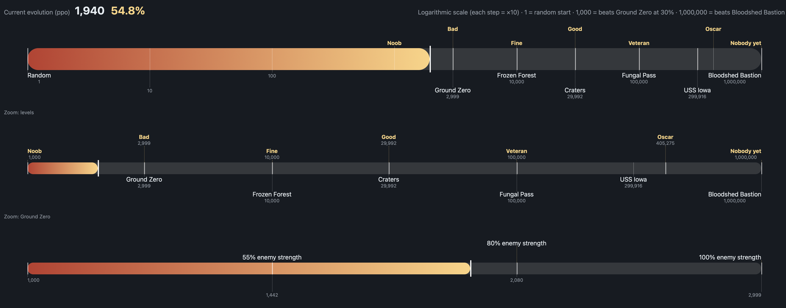

# 2026-11-10: Frustration on Frozen Forest

I ran the map for a while now in the past few days and haven't really gotten anywhere. The bot isn't getting many turrets down to shoot the enemy units. I went back and looked at the earlier levels, and it's actually pretty tough. The first few levels have a steep difficulty curve. Here are some of the things that make it tough:
 * The bot can only see two things: the full map, which is like a picture of the whole level squeezed down into a small picture, and the zoomed map, which shows a small area right around the player's robot. For it to beat the level, it must place turrets in a strategic way to funnel enemies down the right paths down into a chokepoint, which has a really low chance of happening.
 * There are a LOT of actions you can take in Mindustry. You can place a block, of which there are dozens, maybe hundreds, multiplied by the number of available spots to place it at, which gives you thousands of options. You can shoot an enemy, in any location, which adds a hundred options or so. You can command a unit, you can fly around, you can configure a block (choose what you want a block to do), and some more I can't remember. This adds up to thousands and thousands of options. If you picked an action at random 1,000,000 times, it's very unlikely you'd get a single turret to work.
 * You need lots of turrets, probably at least 15 to get a halfway decent score...

 All of these factors combined make it really tough for the AI to win the map.

